# 数据库设计

> 项目名称：城市出租车运营管理与决策支持系统
> 数据库：MySQL 8.0（字符集 utf8mb4），可经 `DATABASE_URL` 切换为 SQLite
> 表的权威定义：`backend/app/models.py`（SQLAlchemy 2.0 声明式 ORM，共 12 张表）
> 本文档所有字段名、类型、默认值、索引均从 `models.py` 逐行读取，未作任何推断或补全。

---

## 1 设计原则

### 1.1 为什么把「需求」与「供给」拆成两张表

系统用两张表分别记录出行的两个侧面：

| 表 | 语义 | 记录的是 | 关键状态取值 |
| --- | --- | --- | --- |
| `ride_request` | 乘客叫车请求（**需求**） | 乘客「想」要一次出行，无论最终有没有车来接 | 0 无人接单 / 1 已接单 / 2 已完成 / 3 已取消 |
| `operation_record` | 营运订单（**供给**） | 实际发生并完成的载客行程 | 无状态字段（只记录已完成行程） |

拆表的理由有四点：

1. **营运订单只能反映被满足的需求，会系统性低估真实需求。** 在运力紧张的时段，大量乘客根本叫不到车，这些出行需求在订单表里完全没有痕迹。如果只用订单表建模，就会形成「需求越缺 → 统计到的需求越低 → 预测越低 → 越不投入运力」的负反馈，把最需要干预的时段判断成「需求不高」。而《核心算法说明》第 1 节明确把预测的数据口径定在 `ride_request` 上，正因为如此。
2. **两张表的「供需缺口」是调度的直接输入。** 缺口测算用「区域×时段的需求量（来自 `ride_request`）」减去「折算运力（来自 `vehicle` 与在岗排班）」，而不是「订单量减去运力」——后者恒为非正数，缺口无从谈起。
3. **两张表的字段集合本就不同。** 需求侧关心等待时长、是否高峰、乘客人数、是否被满足；供给侧关心载客里程、空驶里程、金额、行程时长、平均速度、支付方式。硬塞进一张表会产生大量互相为空的列。
4. **满足率、未满足率、平均等待时长这三个核心指标需要两侧数据才能算出**，拆表后用 `request_no` / `order_no` 的对应关系（`ride_request.order_no` 字段）关联即可，且不影响各自的写入性能。

代价是需要保证两侧一致：仿真生成时对每一条被满足的需求同时写入两张表（需求状态置 2，订单号写入 `ride_request.order_no`），未满足的需求只写需求表。

### 1.2 为什么要有区域表

`region` 表是**需求分析与调度决策的空间基本单元**，它承担四项职责：

1. **提供分析维度。** 没有区域表，所有统计只能停留在「全公司」粒度，无法回答「哪个区域缺车」「哪个区域收入最高」。有了它，`ride_request.region_id`、`operation_record.pickup_region_id` / `dropoff_region_id`、`vehicle.home_region_id`、`driver.home_region_id` 才能对齐到同一套空间网格上做交叉分析。
2. **提供地理坐标以计算调度成本。** 调度收益模型中的距离成本来自区域中心点之间的球面距离（`center_lng` / `center_lat`），再乘以绕行系数折算为实际行驶距离。没有坐标就没有成本项，调度问题会退化成「谁离得近」的定性判断。
3. **承载功能区的出行规律。** `region_type`（交通枢纽、商圈、居民区、学校、景区、医院、工业区）决定了该区域的小时需求形态；`demand_level`（1~5 级）决定了需求的相对规模。仿真数据生成器正是按这两项参数为每个区域生成错开的出行高峰，才使得同一时刻既有缺车区域又有富余区域——**这是跨区调度存在价值的前提**。
4. **提供调度决策的落点。** `dispatch_order.from_region_id` 与 `to_region_id` 都指向 `region`，使每条调度指令都能明确表述为「从哪个区域调往哪个区域」。

### 1.3 为什么预计算冗余字段（stat_date / hour / weekday / is_peak）

`ride_request` 与 `operation_record` 两张表都冗余保存了四个可从时间字段推导出来的列：

| 冗余字段 | 可由什么推出 | 冗余的理由 |
| --- | --- | --- |
| `stat_date` | `request_time.date()` / `start_time.date()` | 让「按天统计」变成对 `DATE` 列的等值/范围过滤，可以直接命中索引；否则要对 `DATETIME` 列做 `DATE()` 函数运算，**函数运算会使索引失效**，7.8 万行以上的表将退化为全表扫描 |
| `hour` | 时间字段的小时部分 | 24 小时供需分布、区域×小时矩阵、热力图都按小时分组；`GROUP BY hour` 直接走索引，无需 `DATE_FORMAT` 计算 |
| `weekday` | 时间字段的星期（0=周一） | 星期分布、星期×小时热力图、以及调度模块「近 4 周同星期同时段均值」都需要它；冗余后只需一次分组即可 |
| `is_peak` | `hour` 是否落在早高峰 7:00–9:00 或晚高峰 17:00–19:00 | 高峰收入占比、高峰/平峰对比是高频查询条件；同时把「高峰的定义」固化为一条可配置规则（`PEAK_HOURS`）在写入时求值，避免每个查询各写一遍判断 |

设计要点与代价：

- **写入时一次算好，读取时反复受益。** 所有写入路径（手工新增、修改、Excel 导入、仿真生成）都统一经过同一套派生逻辑：营运订单走路由层的 `derive_fields()`，叫车需求在 `create_request` 与仿真器中按同一口径赋值。修改订单时也会重算，杜绝「改了时间但派生字段没变」的脏数据。
- **一致性风险由「单一写入通道」控制。** 冗余字段的代价是需要维护一致性；本系统通过把派生逻辑收敛到一个函数来降低风险。
- **`operation_record` 没有冗余 `region_id` 而使用 `pickup_region_id` / `dropoff_region_id` 两个外键**，因为一条行程天然有两个空间端点，调度与区域排行只关心上车点，所以复合索引 `ix_op_region_date` 建立在 `pickup_region_id` 上。

---

## 2 E-R 关系说明

### 2.1 实体分组

12 张表按职责分为四组：

```
基础资源   region（运营区域）· vehicle（车辆）· driver（驾驶员）· vehicle_driver（人车绑定）
运营数据   ride_request（叫车需求）· operation_record（营运订单）
决策支持   forecast_result（预测结果）· dispatch_plan（调度方案）· dispatch_order（调度指令）
系统支撑   sys_user（系统用户）· sys_config（参数配置）· operation_log（操作日志）
```

### 2.2 关系清单

| 关系 | 基数 | 外键 | 说明 |
| --- | --- | --- | --- |
| 区域 — 车辆 | 1 : N | `vehicle.home_region_id → region.id` | 一辆车有一个常驻区域（可为空） |
| 区域 — 驾驶员 | 1 : N | `driver.home_region_id → region.id` | 一名驾驶员有一个常驻区域（可为空） |
| 车辆 — 驾驶员 | M : N（经 `vehicle_driver`） | `vehicle_driver.vehicle_id → vehicle.id`、`vehicle_driver.driver_id → driver.id` | 一辆车可绑多名驾驶员，一名驾驶员也可先后绑多辆车；用 `shift` 与 `status` 表达排班与生效状态 |
| 区域 — 叫车需求 | 1 : N | `ride_request.region_id → region.id` | 每条需求属于一个上车区域（非空） |
| 车辆 — 营运订单 | 1 : N | `operation_record.vehicle_id → vehicle.id` | 订单必属于一辆车 |
| 驾驶员 — 营运订单 | 1 : N | `operation_record.driver_id → driver.id` | 订单必属于一名驾驶员 |
| 区域 — 营运订单（上车） | 1 : N | `operation_record.pickup_region_id → region.id` | 可为空 |
| 区域 — 营运订单（下车） | 1 : N | `operation_record.dropoff_region_id → region.id` | 可为空；与上车区域构成 OD 对 |
| 区域 — 预测结果 | 1 : N | `forecast_result.region_id → region.id` | **可为空**，空值表示全域合计预测 |
| 调度方案 — 调度指令 | 1 : N | `dispatch_order.plan_id → dispatch_plan.id` | ORM 关系配置 `cascade="all, delete-orphan"`，删除方案时级联删除其指令 |
| 车辆 — 调度指令 | 1 : N | `dispatch_order.vehicle_id → vehicle.id` | 每条指令针对一辆车 |
| 驾驶员 — 调度指令 | 1 : N | `dispatch_order.driver_id → driver.id` | 可为空（生成方案时尚未确定具体驾驶员） |
| 区域 — 调度指令（调出/调入） | 1 : N ×2 | `dispatch_order.from_region_id → region.id`、`dispatch_order.to_region_id → region.id` | 两者均非空 |
| 叫车需求 — 营运订单 | 1 : 0..1（逻辑关联） | `ride_request.order_no` ↔ `operation_record.order_no` | **非外键**，通过订单号字符串对应；需求未被满足时为空 |

### 2.3 E-R 图

> 图例：`||--o{` 表示一对多；`}o..||` 表示「逻辑上的多对一，非数据库外键」。
> 实体中的属性名采用驼峰写法以便在各类 Mermaid 渲染器中稳定显示，
> 与 `models.py` 中的下划线列名一一对应（例如 `centerLng` 对应 `center_lng`）。

```mermaid
erDiagram
    region ||--o{ vehicle : "常驻区域"
    region ||--o{ driver : "常驻区域"
    region ||--o{ ride_request : "上车区域"
    region ||--o{ operation_record : "上车区域"
    region ||--o{ operation_record : "下车区域"
    region ||--o{ forecast_result : "预测区域"
    region ||--o{ dispatch_order : "调出区域"
    region ||--o{ dispatch_order : "调入区域"

    vehicle ||--o{ vehicle_driver : "排班绑定"
    driver  ||--o{ vehicle_driver : "排班绑定"

    vehicle ||--o{ operation_record : "承运车辆"
    driver  ||--o{ operation_record : "承运驾驶员"

    vehicle ||--o{ dispatch_order : "被调度车辆"
    driver  ||--o{ dispatch_order : "执行驾驶员"

    dispatch_plan ||--|{ dispatch_order : "包含指令"

    ride_request }o..|| operation_record : "order_no 逻辑对应非外键"

    region {
        bigint  id PK "主键"
        varchar code UK "区域编码"
        varchar name "区域名称"
        varchar regionType "功能区类型"
        decimal centerLng "中心点经度"
        decimal centerLat "中心点纬度"
        decimal areaKm2 "面积 平方公里"
        smallint demandLevel "需求强度 1-5"
        smallint status "1 启用 0 停用"
    }

    vehicle {
        bigint  id PK "主键"
        varchar plateNumber UK "车牌号"
        varchar brandModel "品牌型号"
        varchar vehicleType "车辆类型"
        varchar energyType "能源类型"
        smallint seats "核载人数"
        date    purchaseDate "购置日期"
        decimal mileageTotal "累计里程 公里"
        date    insuranceExpire "保险到期日"
        date    certExpire "营运证到期日"
        date    nextMaintenanceDate "下次保养日"
        bigint  homeRegionId FK "常驻区域"
        smallint status "1 在营 0 停运 2 维修"
    }

    driver {
        bigint  id PK "主键"
        varchar name "姓名"
        char    gender "M 男 F 女"
        varchar idCard UK "身份证号"
        varchar licenseNo "驾驶证号"
        varchar qualificationNo "从业资格证号"
        decimal rating "服务评分 0-5"
        int     complaintCount "投诉次数"
        int     violationCount "违章次数"
        date    licenseExpire "驾驶证有效期至"
        bigint  homeRegionId FK "常驻区域"
        smallint status "1 在职 0 离职 2 休假"
    }

    vehicle_driver {
        bigint  id PK "主键"
        bigint  vehicleId FK "车辆"
        bigint  driverId FK "驾驶员"
        date    assignDate "绑定日期"
        date    unassignDate "解绑日期"
        varchar shift "白班 夜班 全天"
        smallint status "1 生效 0 已解绑"
    }

    ride_request {
        bigint  id PK "主键"
        varchar requestNo UK "请求编号"
        bigint  regionId FK "上车区域"
        datetime requestTime "叫车时间"
        date    statDate "统计日期"
        smallint hour "小时 0-23"
        smallint weekday "星期 0 为周一"
        smallint passengerCount "乘客人数"
        smallint status "0 无人接单 1 已接单 2 已完成 3 已取消"
        int     waitSeconds "等待时长 秒"
        boolean isPeak "是否高峰"
        varchar weather "天气"
        boolean isHoliday "是否节假日"
        varchar orderNo "关联营运订单号"
    }

    operation_record {
        bigint  id PK "主键"
        varchar orderNo UK "订单号"
        bigint  vehicleId FK "车辆"
        bigint  driverId FK "驾驶员"
        bigint  pickupRegionId FK "上车区域"
        bigint  dropoffRegionId FK "下车区域"
        datetime startTime "上车时间"
        datetime endTime "下车时间"
        date    statDate "统计日期"
        smallint hour "上车小时"
        smallint weekday "星期 0 为周一"
        decimal loadedMileage "载客里程 公里"
        decimal emptyMileage "空驶里程 公里"
        decimal amount "订单金额 元"
        decimal durationMinutes "行程时长 分钟"
        decimal avgSpeed "平均速度"
        varchar payType "支付方式"
        boolean isPeak "是否高峰"
    }

    forecast_result {
        bigint  id PK "主键"
        varchar batchNo "预测批次号"
        bigint  regionId FK "区域 空值为全域"
        datetime targetTime "预测目标时刻"
        date    targetDate "目标日期"
        smallint hour "目标小时"
        varchar modelName "所用模型"
        decimal predictedValue "预测需求量 单"
        decimal lowerBound "置信下界"
        decimal upperBound "置信上界"
        decimal actualValue "事后回填真实值"
        decimal mape "回测 MAPE"
        int     horizon "预测步长 小时"
        varchar createdBy "创建人"
    }

    dispatch_plan {
        bigint  id PK "主键"
        varchar planNo UK "方案编号"
        date    planDate "调度日期"
        smallint targetHour "目标时段"
        varchar strategy "greedy 或 hungarian"
        varchar forecastModel "需求估计方法"
        decimal totalDemand "预测总需求"
        decimal totalSupply "可用运力"
        decimal totalGap "总供需缺口"
        int     dispatchCount "调度车辆数"
        decimal expectedGain "预期净收益 元"
        smallint status "0 草稿 1 已下发 2 执行中 3 已完成 4 已取消"
    }

    dispatch_order {
        bigint  id PK "主键"
        bigint  planId FK "所属方案"
        varchar dispatchNo UK "调度单号"
        bigint  vehicleId FK "被调度车辆"
        bigint  driverId FK "执行驾驶员 可空"
        bigint  fromRegionId FK "调出区域"
        bigint  toRegionId FK "调入区域"
        smallint startHour "建议出发时段"
        smallint endHour "目标服务时段"
        decimal predictedDemand "目标区域预测需求"
        decimal predictedSupply "目标区域可用运力"
        decimal gap "缺口 单"
        decimal distanceKm "调度距离 公里"
        decimal expectedRevenue "预期增收 元"
        decimal expectedCost "预期成本 元"
        decimal expectedGain "预期净收益 元"
        smallint priority "1 高 2 中 3 低"
        smallint status "0 待执行 1 执行中 2 已完成 3 已拒绝 4 已取消"
        datetime executedTime "执行时间"
        varchar feedback "执行反馈"
    }

    sys_user {
        bigint  id PK "主键"
        varchar username UK "用户名"
        varchar passwordHash "口令散列 bcrypt"
        varchar realName "真实姓名"
        varchar role "admin operator viewer"
        varchar phone "联系电话"
        smallint status "1 启用 0 禁用"
        datetime lastLogin "最后登录时间"
    }

    sys_config {
        bigint  id PK "主键"
        varchar configKey UK "配置键"
        varchar configValue "配置值 统一存字符串"
        varchar configName "配置名称"
        varchar configGroup "配置分组"
        varchar valueType "int float str bool"
        varchar description "说明"
        datetime updateTime "更新时间"
    }

    operation_log {
        bigint  id PK "主键"
        bigint  userId "用户ID"
        varchar username "用户名"
        varchar module "模块"
        varchar operation "操作描述"
        varchar method "HTTP 方法"
        varchar path "请求路径"
        varchar ip "客户端 IP"
        int     statusCode "响应状态码"
        int     costMs "耗时 毫秒"
        datetime createTime "操作时间"
    }
```



---

## 3 数据表清单

| # | 表名 | 中文名 | 说明 | 预估数据量（默认仿真参数） |
| --- | --- | --- | --- | --- |
| 1 | `region` | 运营区域 | 城市功能区网格，需求分析与调度的空间基本单元 | **10** 条（每个启用区域一条，基本不变） |
| 2 | `vehicle` | 营运车辆 | 车辆档案，含证照到期日、常驻区域与状态 | **60** 条（按车辆规模线性增长） |
| 3 | `driver` | 驾驶员 | 驾驶员档案，含资质、评分与状态 | **80** 条（按驾驶员规模线性增长） |
| 4 | `vehicle_driver` | 人车绑定 | 车辆与驾驶员的排班绑定记录，含班次 | **约 73** 条（每车至少 1 条，约 25% 车辆配双班司机，受在职驾驶员数量约束） |
| 5 | `ride_request` | 叫车需求 | 需求侧原始记录，**包含未被满足的请求** | **约 7.8 万** 条（60 天 × 10 区域 × 24 小时，实测 78305 条） |
| 6 | `operation_record` | 营运订单 | 供给侧已完成行程记录 | **约 6 万** 条（满足率约 76.5%，实测 59944 条） |
| 7 | `forecast_result` | 需求预测结果 | 每次预测按「1 小时 1 条」留存，用于回溯与准确率评估 | **每次预测累积 24 条**（horizon=24 时）；每次预测（全域 + 10 区域各一次）累积 264 条 |
| 8 | `dispatch_plan` | 调度方案 | 一次生成的整批调度建议 | 每次生成方案 1 条，按调度频次线性增长 |
| 9 | `dispatch_order` | 调度指令 | 针对单车的具体调度动作 | 每个方案 0~N 条（受盈余车辆数与缺口槽位数共同约束） |
| 10 | `sys_user` | 系统用户 | 登录账号与角色 | **3** 条（admin / dispatcher / viewer），按需增加 |
| 11 | `sys_config` | 参数配置 | 19 项业务阈值与算法参数 | **19** 条（固定，启动时自动补齐） |
| 12 | `operation_log` | 操作日志 | 所有写操作的审计记录 | 与写操作次数同阶；每份导出/导入/修改各 1 条 |

> 表中「实测」数值取自运行中系统的 `GET /api/system/data/stats`，对应默认仿真参数（60 天 / 60 车 / 80 名驾驶员 / 种子 20240501）。

**数据量增长特征**

| 表 | 增长方式 | 60 天 → 365 天的量级外推 |
| --- | --- | --- |
| `ride_request` | 与天数、车辆数、驾驶员数正相关（需求规模由在岗运力自动标定） | 约 7.8 万 → 约 47 万 |
| `operation_record` | 同上，约为需求量的 76% | 约 6 万 → 约 36 万 |
| `forecast_result` | 与预测次数成正比 | 取决于使用频次，与天数无关 |
| `dispatch_*` | 与调度频次成正比 | 取决于使用频次，与天数无关 |
| `operation_log` | 与写操作次数成正比 | 取决于使用频次 |

---

## 4 逐表详细设计

> **说明**：下表字段严格取自 `backend/app/models.py` 中的 `Column(...)` 声明。「允许空」一栏中，「是」表示该列未声明 `nullable=False`（SQLAlchemy 默认允许为空），「否」表示显式声明了 `nullable=False`。所有表均未使用数据库级 `DEFAULT` 子句，默认值由 SQLAlchemy 在 ORM 层填充；ORM 未声明默认值的可空列，插入时若不赋值即为数据库 `NULL`。

### 4.1 region 运营区域

| 字段名 | 类型 | 允许空 | 默认值 | 说明 |
| --- | --- | --- | --- | --- |
| `id` | BigInteger | 否 | 自增 | 主键 |
| `code` | String(20) | 否 | — | 区域编码（唯一） |
| `name` | String(50) | 否 | — | 区域名称 |
| `region_type` | String(20) | 是 | `居民区` | 功能区类型 |
| `center_lng` | Numeric(10,6) | 是 | — | 中心点经度 |
| `center_lat` | Numeric(10,6) | 是 | — | 中心点纬度 |
| `area_km2` | Numeric(8,2) | 是 | `10` | 面积(平方公里) |
| `demand_level` | SmallInteger | 是 | `3` | 需求强度等级 1-5 |
| `status` | SmallInteger | 是 | `1` | 1 启用 0 停用 |
| `remark` | String(200) | 是 | — | 备注 |
| `create_time` | DateTime | 是 | `datetime.now` | 创建时间 |

- **主键**：`id`
- **唯一约束**：`code`（`unique=True`）。同时因 `index=True`，会建立唯一索引 `ix_region_code`。
- **索引**：`id` 上的 `ix_region_id`、`code` 上的唯一索引 `ix_region_code`
- **外键**：本表无外键；被 `vehicle`、`driver`、`ride_request`、`operation_record`、`forecast_result`、`dispatch_order` 引用
- **ORM 关系**：`requests`（→ RideRequest）、`pickups`（→ OperationRecord，按 `pickup_region_id`）
- **实际取值参考**：仿真生成 10 个区域，编码 R01~R10，功能区类型覆盖交通枢纽、商圈、工业区、学校、居民区、景区、医院 7 类，需求强度取 2~5

### 4.2 vehicle 营运车辆

| 字段名 | 类型 | 允许空 | 默认值 | 说明 |
| --- | --- | --- | --- | --- |
| `id` | BigInteger | 否 | 自增 | 主键 |
| `plate_number` | String(20) | 否 | — | 车牌号（唯一） |
| `brand_model` | String(50) | 否 | — | 品牌型号 |
| `color` | String(20) | 是 | — | 颜色 |
| `vehicle_type` | String(20) | 是 | `巡游出租车` | 车辆类型 |
| `energy_type` | String(10) | 是 | `燃油` | 能源类型 |
| `seats` | SmallInteger | 是 | `5` | 核载人数 |
| `purchase_date` | Date | 是 | — | 购置日期 |
| `purchase_price` | Numeric(10,2) | 是 | — | 购置价格(万元) |
| `mileage_total` | Numeric(12,2) | 是 | `0` | 累计里程(公里) |
| `insurance_expire` | Date | 是 | — | 保险到期日 |
| `cert_expire` | Date | 是 | — | 营运证到期日 |
| `next_maintenance_date` | Date | 是 | — | 下次保养日期 |
| `maintenance_cycle_days` | Integer | 是 | `90` | 保养周期(天) |
| `home_region_id` | BigInteger | 是 | — | 常驻区域（外键 → `region.id`） |
| `status` | SmallInteger | 是 | `1` | 1 在营 0 停运 2 维修 |
| `remark` | String(200) | 是 | — | 备注 |
| `create_time` | DateTime | 是 | `datetime.now` | 创建时间 |
| `update_time` | DateTime | 是 | `datetime.now`（更新时自动刷新） | 更新时间 |

- **主键**：`id`
- **唯一约束**：`plate_number`（唯一）
- **外键**：`home_region_id → region.id`
- **索引**：`id` 上的 `ix_vehicle_id`、`plate_number` 上的唯一索引
- **ORM 关系**：`home_region`（→ Region）、`operation_records`（→ OperationRecord）、`assignments`（→ VehicleDriver）、`dispatch_orders`（→ DispatchOrder）
- **业务约束（应用层）**：车牌号重复新增/修改返回 400；已产生营运记录的车辆不可删除，只能改为停运（见《系统设计说明》7.6 节）
- **注意**：`Numeric(10,2)` 的 `purchase_price` 在代码注释中标注为「万元」

### 4.3 driver 驾驶员

| 字段名 | 类型 | 允许空 | 默认值 | 说明 |
| --- | --- | --- | --- | --- |
| `id` | BigInteger | 否 | 自增 | 主键 |
| `name` | String(30) | 否 | — | 姓名 |
| `gender` | CHAR(1) | 是 | `M` | M 男 F 女 |
| `id_card` | String(18) | 否 | — | 身份证号（唯一） |
| `license_no` | String(20) | 否 | — | 驾驶证号 |
| `qualification_no` | String(30) | 是 | — | 从业资格证号 |
| `phone` | String(15) | 是 | — | 联系电话 |
| `birth_date` | Date | 是 | — | 出生日期 |
| `hire_date` | Date | 是 | — | 入职日期 |
| `license_expire` | Date | 是 | — | 驾驶证有效期至 |
| `rating` | Numeric(3,2) | 是 | `5.00` | 服务评分 0-5 |
| `complaint_count` | Integer | 是 | `0` | 投诉次数 |
| `violation_count` | Integer | 是 | `0` | 违章次数 |
| `home_region_id` | BigInteger | 是 | — | 常驻区域（外键 → `region.id`） |
| `status` | SmallInteger | 是 | `1` | 1 在职 0 离职 2 休假 |
| `remark` | String(200) | 是 | — | 备注 |
| `create_time` | DateTime | 是 | `datetime.now` | 创建时间 |
| `update_time` | DateTime | 是 | `datetime.now`（更新时自动刷新） | 更新时间 |

- **主键**：`id`
- **唯一约束**：`id_card`（唯一）
- **外键**：`home_region_id → region.id`
- **索引**：`id` 上的 `ix_driver_id`、`id_card` 上的唯一索引
- **ORM 关系**：`home_region`、`operation_records`、`assignments`、`dispatch_orders`
- **业务约束（应用层）**：身份证号唯一；列表与详情对身份证号脱敏；已产生营运记录的驾驶员不可删除，只能改为离职

### 4.4 vehicle_driver 人车绑定

| 字段名 | 类型 | 允许空 | 默认值 | 说明 |
| --- | --- | --- | --- | --- |
| `id` | BigInteger | 否 | 自增 | 主键 |
| `vehicle_id` | BigInteger | 否 | — | 车辆（外键 → `vehicle.id`） |
| `driver_id` | BigInteger | 否 | — | 驾驶员（外键 → `driver.id`） |
| `assign_date` | Date | 是 | — | 绑定日期 |
| `unassign_date` | Date | 是 | `NULL` | 解绑日期 |
| `shift` | String(10) | 是 | `白班` | 班次：白班/夜班/全天 |
| `status` | SmallInteger | 是 | `1` | 1 生效 0 已解绑 |
| `remark` | String(200) | 是 | — | 备注 |
| `create_time` | DateTime | 是 | `datetime.now` | 创建时间 |

- **主键**：`id`
- **唯一约束**：无（同一车同一驾驶员历史上可以多次绑定，用 `status` 与日期区分）
- **外键**：`vehicle_id → vehicle.id`、`driver_id → driver.id`
- **索引**：`id` 上的 `ix_vehicle_driver_id`
- **ORM 关系**：`vehicle`、`driver`
- **业务约束（应用层）**：同一车辆与同一驾驶员不能同时存在两条生效绑定；同一车辆同一班次的生效绑定最多 2 条；解绑采用「置 `status=0` 并写 `unassign_date`」而非物理删除，保留排班历史
- **班次的时间语义**（由仿真器与运力盘点共同使用）：白班 6:00–18:00，夜班 18:00–次日 6:00，全天覆盖 24 小时

### 4.5 ride_request 叫车需求

| 字段名 | 类型 | 允许空 | 默认值 | 说明 |
| --- | --- | --- | --- | --- |
| `id` | BigInteger | 否 | 自增 | 主键 |
| `request_no` | String(32) | 否 | — | 请求编号（唯一） |
| `region_id` | BigInteger | 否 | — | 上车区域（外键 → `region.id`） |
| `request_time` | DateTime | 否 | — | 叫车时间 |
| `stat_date` | Date | 否 | — | 统计日期（冗余） |
| `hour` | SmallInteger | 否 | — | 小时 0-23（冗余） |
| `weekday` | SmallInteger | 否 | — | 星期 0=周一（冗余） |
| `passenger_count` | SmallInteger | 是 | `1` | 乘客人数 |
| `status` | SmallInteger | 是 | `1` | 0 无人接单 1 已接单 2 已完成 3 已取消 |
| `wait_seconds` | Integer | 是 | `0` | 等待时长(秒) |
| `is_peak` | Boolean | 是 | `False` | 是否高峰时段（冗余） |
| `weather` | String(10) | 是 | `晴` | 天气 |
| `is_holiday` | Boolean | 是 | `False` | 是否节假日 |
| `order_no` | String(32) | 是 | `NULL` | 关联的营运订单号（非外键） |
| `create_time` | DateTime | 是 | `datetime.now` | 创建时间 |

- **主键**：`id`
- **唯一约束**：`request_no`（唯一）
- **外键**：`region_id → region.id`（非空）
- **索引**：
  - 单列：`id`、`region_id`、`request_time`、`stat_date` 均声明了 `index=True`，其中 `region_id` 的索引通过 `ForeignKey` 声明中的 `index=True` 建立
  - 复合：`ix_request_region_time (region_id, request_time)`、`ix_request_date_hour (stat_date, hour)`
- **ORM 关系**：`region`
- **写入口径**：新增请求时自动按 `request_time` 派生 `stat_date` / `hour` / `weekday`；`request_no` 未提供时按 `REQ + 时间戳` 自动生成
- **仿真生成的真实分布**：被满足的请求状态置 2 并写入 `order_no`；未满足的请求按 35% 概率置 3（已取消）、否则置 0（无人接单）

### 4.6 operation_record 营运订单

| 字段名 | 类型 | 允许空 | 默认值 | 说明 |
| --- | --- | --- | --- | --- |
| `id` | BigInteger | 否 | 自增 | 主键 |
| `order_no` | String(32) | 否 | — | 订单号（唯一） |
| `vehicle_id` | BigInteger | 否 | — | 车辆（外键 → `vehicle.id`） |
| `driver_id` | BigInteger | 否 | — | 驾驶员（外键 → `driver.id`） |
| `pickup_region_id` | BigInteger | 是 | — | 上车区域（外键 → `region.id`） |
| `dropoff_region_id` | BigInteger | 是 | — | 下车区域（外键 → `region.id`） |
| `start_time` | DateTime | 否 | — | 上车时间 |
| `end_time` | DateTime | 否 | — | 下车时间 |
| `stat_date` | Date | 否 | — | 统计日期（冗余） |
| `hour` | SmallInteger | 否 | — | 上车小时（冗余） |
| `weekday` | SmallInteger | 否 | — | 星期 0=周一（冗余） |
| `loaded_mileage` | Numeric(10,2) | 否 | — | 载客里程(公里) |
| `empty_mileage` | Numeric(10,2) | 否 | — | 空驶里程(公里) |
| `amount` | Numeric(10,2) | 否 | — | 订单金额(元) |
| `duration_minutes` | Numeric(8,2) | 是 | `0` | 行程时长(分钟)（派生） |
| `avg_speed` | Numeric(6,2) | 是 | `0` | 平均速度(公里/小时)（派生） |
| `passenger_count` | SmallInteger | 是 | `1` | 乘客人数 |
| `pay_type` | String(10) | 是 | `微信` | 支付方式 |
| `weather` | String(10) | 是 | `晴` | 天气 |
| `is_peak` | Boolean | 是 | `False` | 是否高峰时段（冗余） |
| `is_holiday` | Boolean | 是 | `False` | 是否节假日 |
| `create_time` | DateTime | 是 | `datetime.now` | 创建时间 |

- **主键**：`id`
- **唯一约束**：`order_no`（唯一）
- **外键**：`vehicle_id → vehicle.id`（非空）、`driver_id → driver.id`（非空）、`pickup_region_id → region.id`（可空）、`dropoff_region_id → region.id`（可空）
- **索引**：
  - 单列：`id`、`start_time`、`stat_date`
  - 复合：`ix_op_vehicle_date (vehicle_id, stat_date)`、`ix_op_driver_date (driver_id, stat_date)`、`ix_op_region_date (pickup_region_id, stat_date)`、`ix_op_date_hour (stat_date, hour)`
- **ORM 关系**：`vehicle`、`driver`、`pickup_region`、`dropoff_region`
- **派生字段的生成规则**（`routers/operation.py :: derive_fields`）：
  `stat_date = start_time.date()`；`hour = start_time.hour`；`weekday = start_time.weekday()`；`is_peak = hour ∈ [7,9) ∪ [17,19)`；`duration_minutes = (end_time − start_time)/60s`；`avg_speed = loaded_mileage ÷ (duration_minutes/60)`（时长为 0 时取 0）；若 `end_time < start_time` 则拒绝写入并返回 400
- **注意**：`start_time` 与 `end_time` 均为非空，`loaded_mileage`、`empty_mileage`、`amount` 也均为非空，因此订单的三要素（时间、里程、金额）不允许缺失

### 4.7 forecast_result 需求预测结果

| 字段名 | 类型 | 允许空 | 默认值 | 说明 |
| --- | --- | --- | --- | --- |
| `id` | BigInteger | 否 | 自增 | 主键 |
| `batch_no` | String(32) | 否 | — | 预测批次号 |
| `region_id` | BigInteger | 是 | `NULL` | 区域，NULL 表示全域（外键 → `region.id`） |
| `target_time` | DateTime | 否 | — | 预测目标时刻 |
| `target_date` | Date | 否 | — | 目标日期（冗余） |
| `hour` | SmallInteger | 否 | — | 目标小时（冗余） |
| `model_name` | String(30) | 否 | — | 所用模型 |
| `predicted_value` | Numeric(10,2) | 否 | — | 预测需求量(单) |
| `lower_bound` | Numeric(10,2) | 是 | — | 置信下界 |
| `upper_bound` | Numeric(10,2) | 是 | — | 置信上界 |
| `actual_value` | Numeric(10,2) | 是 | `NULL` | 事后回填的真实值 |
| `mape` | Numeric(6,2) | 是 | — | 该模型回测 MAPE(%) |
| `horizon` | Integer | 是 | `24` | 预测步长(小时) |
| `created_by` | String(30) | 是 | — | 创建人（用户名） |
| `create_time` | DateTime | 是 | `datetime.now` | 创建时间 |

- **主键**：`id`
- **唯一约束**：无（同一批次内每条记录是「一个时刻」的一条预测，批次号 + 目标时刻在业务上唯一，但未建数据库唯一约束）
- **外键**：`region_id → region.id`（可为空，空值表示全域合计）
- **索引**：`id`、`batch_no`、`target_time`、`target_date` 四列均声明 `index=True`
- **ORM 关系**：`region`
- **写入口径**：一次预测写入 `horizon` 条记录（默认 24 条），原子映射为「一个预测点一条」，便于按批次回溯与逐点回填真实值；`mape` 取自最优模型的回测 MAPE
- **批次号格式**：`FC + YYYYMMDDHHMMSS + 3 位随机数`

### 4.8 dispatch_plan 调度方案

| 字段名 | 类型 | 允许空 | 默认值 | 说明 |
| --- | --- | --- | --- | --- |
| `id` | BigInteger | 否 | 自增 | 主键 |
| `plan_no` | String(32) | 否 | — | 方案编号（唯一） |
| `plan_date` | Date | 否 | — | 调度日期 |
| `target_hour` | SmallInteger | 否 | — | 目标时段(小时) |
| `strategy` | String(30) | 是 | `greedy` | greedy 贪心 / hungarian 匈牙利最优 |
| `forecast_model` | String(30) | 是 | — | 需求估计所用方法 |
| `total_demand` | Numeric(12,2) | 是 | `0` | 预测总需求 |
| `total_supply` | Numeric(12,2) | 是 | `0` | 可用运力（折算后） |
| `total_gap` | Numeric(12,2) | 是 | `0` | 总供需缺口 |
| `dispatch_count` | Integer | 是 | `0` | 调度车辆数 |
| `expected_gain` | Numeric(12,2) | 是 | `0` | 预期净收益(元) |
| `status` | SmallInteger | 是 | `0` | 0 草稿 1 已下发 2 执行中 3 已完成 4 已取消 |
| `remark` | String(255) | 是 | — | 备注（记录目标时段、需求估计方法、调度策略） |
| `created_by` | String(30) | 是 | — | 创建人（用户名） |
| `create_time` | DateTime | 是 | `datetime.now` | 创建时间 |

- **主键**：`id`
- **唯一约束**：`plan_no`（唯一）
- **外键**：无
- **索引**：`id` 上的 `ix_dispatch_plan_id`、`plan_date`、`plan_no` 上的唯一索引
- **ORM 关系**：`orders`（→ DispatchOrder，配置 `cascade="all, delete-orphan"`，删除方案时级联删除其调度指令）
- **业务约束（应用层）**：状态为 1（已下发）或 2（执行中）的方案不可删除
- **方案号格式**：`DP + YYYYMMDD + 两位时段 + 3 位随机数`
- **注意**：ORM 默认值为 `greedy`，但接口层的默认策略是 `hungarian`（`DispatchGenerateRequest.strategy` 默认值）

### 4.9 dispatch_order 调度指令

| 字段名 | 类型 | 允许空 | 默认值 | 说明 |
| --- | --- | --- | --- | --- |
| `id` | BigInteger | 否 | 自增 | 主键 |
| `plan_id` | BigInteger | 否 | — | 所属方案（外键 → `dispatch_plan.id`） |
| `dispatch_no` | String(32) | 否 | — | 调度单号（唯一） |
| `vehicle_id` | BigInteger | 否 | — | 被调度车辆（外键 → `vehicle.id`） |
| `driver_id` | BigInteger | 是 | `NULL` | 执行驾驶员（外键 → `driver.id`） |
| `from_region_id` | BigInteger | 否 | — | 调出区域（外键 → `region.id`） |
| `to_region_id` | BigInteger | 否 | — | 调入区域（外键 → `region.id`） |
| `start_hour` | SmallInteger | 否 | — | 建议出发时段 |
| `end_hour` | SmallInteger | 否 | — | 目标服务时段 |
| `predicted_demand` | Numeric(10,2) | 是 | — | 目标区域预测需求 |
| `predicted_supply` | Numeric(10,2) | 是 | — | 目标区域可用运力 |
| `gap` | Numeric(10,2) | 是 | — | 缺口(单) |
| `distance_km` | Numeric(8,2) | 是 | — | 调度距离(公里) |
| `expected_revenue` | Numeric(10,2) | 是 | — | 预期增收(元) |
| `expected_cost` | Numeric(10,2) | 是 | — | 预期成本(元) |
| `expected_gain` | Numeric(10,2) | 是 | — | 预期净收益(元) |
| `priority` | SmallInteger | 是 | `3` | 优先级 1 高 2 中 3 低 |
| `status` | SmallInteger | 是 | `0` | 0 待执行 1 执行中 2 已完成 3 已拒绝 4 已取消 |
| `executed_time` | DateTime | 是 | `NULL` | 执行时间（反馈为 2/3/4 时写入） |
| `feedback` | String(255) | 是 | — | 执行反馈 |
| `remark` | String(255) | 是 | — | 备注 |
| `create_time` | DateTime | 是 | `datetime.now` | 创建时间 |

- **主键**：`id`
- **唯一约束**：`dispatch_no`（唯一）
- **外键**：`plan_id → dispatch_plan.id`（非空）、`vehicle_id → vehicle.id`（非空）、`driver_id → driver.id`（可空）、`from_region_id → region.id`（非空）、`to_region_id → region.id`（非空）
- **索引**：
  - 单列：`id`、`plan_id`（`ForeignKey` 中声明 `index=True`）、`dispatch_no` 上的唯一索引
  - 复合：`ix_dispatch_plan_status (plan_id, status)`、`ix_dispatch_target (to_region_id, start_hour)`
- **ORM 关系**：`plan`、`vehicle`、`driver`、`from_region`、`to_region`
- **业务约束（应用层）**：反馈状态仅允许 1/2/3/4；处于 2/3/4 终态的指令不可重复提交反馈；当方案内所有指令都离开「待执行(0)/执行中(1)」时，方案状态自动置为 3（已完成）
- **调度单号格式**：`{方案号}-{三位序号}`
- **优先级赋值规则**：目标区域为严重缺口 → 1，明显缺口 → 2，其余 → 3

### 4.10 sys_user 系统用户

| 字段名 | 类型 | 允许空 | 默认值 | 说明 |
| --- | --- | --- | --- | --- |
| `id` | BigInteger | 否 | 自增 | 主键 |
| `username` | String(30) | 否 | — | 用户名（唯一） |
| `password_hash` | String(100) | 否 | — | 口令散列（bcrypt） |
| `real_name` | String(30) | 是 | — | 真实姓名 |
| `role` | String(20) | 是 | `operator` | admin 管理员 / operator 调度员 / viewer 只读 |
| `phone` | String(15) | 是 | — | 联系电话 |
| `status` | SmallInteger | 是 | `1` | 1 启用 0 禁用 |
| `last_login` | DateTime | 是 | — | 最后登录时间（登录成功时更新） |
| `create_time` | DateTime | 是 | `datetime.now` | 创建时间 |

- **主键**：`id`
- **唯一约束**：`username`（唯一）
- **外键**：无
- **索引**：`id` 上的 `ix_sys_user_id`、`username` 上的唯一索引
- **ORM 关系**：无
- **业务约束（应用层）**：`role` 取值限定为 admin / operator / viewer，非法值返回 400；不能禁用或删除当前登录账号；内置 `admin` 账号不可删除
- **初始数据**：`init_db.py` 创建 3 个账号——admin（系统管理员）、dispatcher（调度员，role=operator）、viewer（只读用户）

### 4.11 sys_config 参数配置

| 字段名 | 类型 | 允许空 | 默认值 | 说明 |
| --- | --- | --- | --- | --- |
| `id` | BigInteger | 否 | 自增 | 主键 |
| `config_key` | String(50) | 否 | — | 配置键（唯一） |
| `config_value` | String(200) | 否 | — | 配置值（统一以字符串存储） |
| `config_name` | String(50) | 是 | — | 配置名称 |
| `config_group` | String(30) | 是 | `业务参数` | 配置分组 |
| `value_type` | String(10) | 是 | `float` | int/float/str/bool |
| `description` | String(255) | 是 | — | 说明 |
| `update_time` | DateTime | 是 | `datetime.now`（更新时自动刷新） | 更新时间 |

- **主键**：`id`
- **唯一约束**：`config_key`（唯一）
- **外键**：无
- **索引**：`id` 上的 `ix_sys_config_id`、`config_key` 上的唯一索引
- **ORM 关系**：无
- **关键设计**：`config_value` 统一以 `String(200)` 存储，读取时依据 `value_type` 转型后覆盖到运行时配置单例，因此新增参数**不需要改表结构**
- **初始数据**：19 项，分 4 组（运营分析 3、调度决策 7、需求预测 5、预警提醒 4），清单见《系统设计说明》7.4 节
- **重要例外**：`PEAK_HOURS`（早晚高峰时段定义，默认 `[(7,9),(17,19)]`）不是数据库配置项，只存在于 `app/config.py`，因此修改它需要改代码或经 `.env` 无法覆盖（它是列表字面量）

### 4.12 operation_log 操作日志

| 字段名 | 类型 | 允许空 | 默认值 | 说明 |
| --- | --- | --- | --- | --- |
| `id` | BigInteger | 否 | 自增 | 主键 |
| `user_id` | BigInteger | 是 | `NULL` | 用户 ID |
| `username` | String(30) | 是 | — | 用户名（从令牌解析） |
| `module` | String(30) | 是 | — | 模块（由路径前缀映射的中文名） |
| `operation` | String(100) | 是 | — | 操作描述 |
| `method` | String(10) | 是 | — | HTTP 方法 |
| `path` | String(200) | 是 | — | 请求路径（截断 200 字符） |
| `ip` | String(50) | 是 | — | 客户端 IP |
| `status_code` | Integer | 是 | — | 响应状态码 |
| `cost_ms` | Integer | 是 | — | 耗时(毫秒) |
| `create_time` | DateTime | 是 | `datetime.now` | 操作时间 |

- **主键**：`id`
- **唯一约束**：无
- **外键**：无（`user_id` 为普通列，未声明外键，避免用户删除后日志产生悬空引用）
- **索引**：`id` 上的 `ix_operation_log_id`、`create_time`
- **ORM 关系**：无
- **写入口径**：由 `OperationLogMiddleware` 对全部 `POST/PUT/PATCH/DELETE` 且路径以 `/api` 开头的请求记录；`/api/system/logs` 被显式跳过
- **注意**：`user_id` 字段在模型中存在，但中间件当前**只写入 `username` 而不写 `user_id`**，因此该列实际恒为 `NULL`

---

## 5 索引设计

### 5.1 索引清单

**单列索引**（由 `index=True` 声明产生，命名规则 `ix_<表名>_<列名>`）

| 表 | 索引列 | 服务的查询场景 |
| --- | --- | --- |
| `region` | `id`、`code` | 主键查找；按编码查询 |
| `vehicle` | `id`、`plate_number` | 主键查找；按车牌精确查询 / 导入时按车牌批量映射 |
| `driver` | `id`、`id_card` | 主键查找；身份证号唯一性校验与精确查询 |
| `vehicle_driver` | `id` | 主键查找 |
| `ride_request` | `id`、`region_id`、`request_time`、`stat_date` | 主键；按区域筛选；按时间倒序分页；按日期过滤 |
| `operation_record` | `id`、`start_time`、`stat_date` | 主键；按时间区间过滤与倒序分页；按日期过滤 |
| `forecast_result` | `id`、`batch_no`、`target_time`、`target_date` | 主键；按批次汇总与查询明细；按目标时刻排序；按日期过滤 |
| `dispatch_plan` | `id`、`plan_date` | 主键；按调度日期区间筛选 |
| `dispatch_order` | `id`、`plan_id` | 主键；按方案取指令列表 |
| `sys_user` | `id` | 主键；登录时按 `username` 走唯一索引 |
| `sys_config` | `id` | 主键；按 `config_key` 走唯一索引 |
| `operation_log` | `id`、`create_time` | 主键；按最近 N 天过滤与按时间排序 |

**唯一索引**（`unique=True`）

| 表 | 列 | 业务含义 |
| --- | --- | --- |
| `region` | `code` | 区域编码不可重复 |
| `vehicle` | `plate_number` | 车牌号不可重复 |
| `driver` | `id_card` | 身份证号不可重复 |
| `ride_request` | `request_no` | 请求编号不可重复 |
| `operation_record` | `order_no` | 订单号不可重复 |
| `dispatch_plan` | `plan_no` | 方案编号不可重复 |
| `dispatch_order` | `dispatch_no` | 调度单号不可重复 |
| `sys_user` | `username` | 用户名不可重复 |
| `sys_config` | `config_key` | 配置键不可重复 |

**复合索引**（共 8 个）

| 索引名 | 表 | 索引列 | 服务的查询场景 |
| --- | --- | --- | --- |
| `ix_request_region_time` | `ride_request` | `(region_id, request_time)` | 「某区域近 N 天的叫车需求」：先按区域等值定位，再按时间范围扫描，避免先扫全表再过滤区域 |
| `ix_request_date_hour` | `ride_request` | `(stat_date, hour)` | **按时段聚合的统计查询**：24 小时供需分布、需求汇总（按小时分组）、区域×小时矩阵、预测引擎按 `(日期, 小时)` 分组计数 |
| `ix_op_vehicle_date` | `operation_record` | `(vehicle_id, stat_date)` | 车辆效率排行、车辆详情页的历史单量与累计收入、单车日均营收统计 |
| `ix_op_driver_date` | `operation_record` | `(driver_id, stat_date)` | 驾驶员绩效排行、驾驶员详情页的历史单量与收入、人车绑定页的关联绩效 |
| `ix_op_region_date` | `operation_record` | `(pickup_region_id, stat_date)` | 区域收入排行、区域雷达对比、里程利用率按区域下钻、调度效果评估取「目标区域目标时段收入」 |
| `ix_op_date_hour` | `operation_record` | `(stat_date, hour)` | **按时段聚合的统计查询**：24 小时供给分布、星期×小时热力图的供给侧、按小时聚合的收入 |
| `ix_dispatch_plan_status` | `dispatch_order` | `(plan_id, status)` | 方案详情页统计「已完成指令数」、提交反馈后判断方案是否全部结束（`plan_id IN (...) AND status IN (0,1)`） |
| `ix_dispatch_target` | `dispatch_order` | `(to_region_id, start_hour)` | 按调入区域与目标时段筛选调度指令；运力盘点时统计已被占用的运力 |

### 5.2 索引设计的取舍

| 决策 | 理由 |
| --- | --- |
| 所有日期区间查询统一用 `[起 00:00, 止次日 00:00)` 半开区间，而不是对时间列做 `DATE()` 运算 | 保持谓词是「列 ⋈ 常量」的形式，索引才能生效 |
| 过滤条件中同时存在 `start_time` 范围与 `hour` 等值时不依赖 `is_peak` 索引 | `is_peak` 是低基数布尔列（只有两个取值），单独建索引选择性极差；但它参与复合条件时对分区式扫描无帮助，因此**不为它建索引**，只作为过滤条件使用 |
| `pickup_region_id` 没有单列索引，只出现在复合索引的首列 | 按区域查询必然伴随日期范围（业务上不存在「不限时间的区域查询」），因此复合索引 `(pickup_region_id, stat_date)` 已完全覆盖，避免多余索引增加写入开销 |
| `operation_log.create_time` 建单列索引但不建复合索引 | 该表只按时间倒序分页、按模块等值过滤；模块的取值只有 12 个（低基数），为它单独建索引收益有限 |
| `forecast_result.batch_no` 建索引而非唯一约束 | 同一批次号下有多条记录（每个预测时刻一条），不能做唯一约束；但批次号是最高频的查询入口，必须有索引 |

---

## 6 数据量估算

### 6.1 默认仿真参数

默认参数为：**60 天 / 60 台车 / 80 名驾驶员 / 随机种子 20240501**。需求规模不是硬编码，而是**由在岗运力自动标定**：

```
平均在岗车辆数 = Σ_{24 小时} Σ_{10 区域} 该小时在岗车辆数 ÷ 24
目标小时需求量 = 平均在岗车辆数 × 单车小时服务能力(1.5) × 目标负荷率(0.85)
```

然后按各区域的 `demand_level × 区域作息形态均值` 分摊到 10 个区域，再逐小时叠加日周期（早晚高峰系数最高 2.10）、周周期（周五 1.18、周日 0.95）、天气（雨 1.22、雪 0.85）、节假日（1.18）与缓慢增长趋势（每天 +0.09%），最后用泊松过程抽样。

### 6.2 各表量级估算与实测对照

| 表 | 估算依据 | 估算量级 | 实测值 | 说明 |
| --- | --- | --- | --- | --- |
| `region` | 固定 10 个功能区 | 10 | **10** | 与参数无关 |
| `vehicle` | 参数 `vehicles` | 60 | **60** | 线性 |
| `driver` | 参数 `drivers` | 80 | **80** | 线性 |
| `vehicle_driver` | 每车 ≥ 1 条，约 25% 车辆配双班 | 60 + 0.25×60 ≈ 75（受在职驾驶员数上限 80×0.95≈76 约束） | **73** | 受司机池耗尽而略低于理论值 |
| `ride_request` | 10 区域 × 24 小时 × 60 天 × 区域时段平均需求量 | 约 7.8 万 | **78305** | 约 54.4 条/小时（全城） |
| `operation_record` | 需求量 × 平均满足率 | 约 6 万 | **59944** | 满足率 = 59944/78305 ≈ **76.5%** |
| `forecast_result` | 每次预测写入 `horizon` 条 | 每次预测 24 条 | 144（6 次预测） | 与天数无关，与预测调用次数成正比 |
| `dispatch_plan` | 每次生成方案 1 条 | — | 3 | 与调度频次成正比 |
| `dispatch_order` | 每方案 0~N 条 | — | 12 | 与方案数和调度规模成正比 |
| `sys_user` | 初始 3 个账号 | 3 | **3** | — |
| `sys_config` | 固定 19 项 | 19 | 19（启动时自动补齐） | 与参数无关 |
| `operation_log` | 每次写操作 1 条 | 与使用频次同阶 | 100（当前演示环境） | 与天数无关 |

### 6.3 关键派生指标（用于论文中的数据集描述）

| 指标 | 数值 | 计算方式 |
| --- | --- | --- |
| 数据时间跨度 | 60 天 | 参数 `days` |
| 观测点数量（全域小时序列） | 1440 | 60 天 × 24 小时 |
| 区域×小时序列的观测点 | 14400 | 10 区域 × 1440 |
| 全城平均需求强度 | 约 54.4 单/小时 | 78305 ÷ 1440 |
| 平均满足率 | 约 76.5% | 59944 ÷ 78305 |
| 未被满足的需求量 | 约 1.84 万单 | 78305 − 59944 |
| 平均在岗车辆数 | 约 26~30 台 | 受白班/夜班/全天班次覆盖影响，任一时刻只有在岗车辆计入运力 |
| 平均负荷率（需求 ÷ 折算运力） | 约 0.85 | 由仿真器显式标定 |
| 高峰与平峰的满足率差 | 平峰约 95%+，早晚高峰约 60% | 满足率随该区域该小时「运力/需求」比下降 |

### 6.4 数据量增长与容量规划

| 表 | 每增加 1 天 | 每增加 1 次预测 | 每增加 1 个调度方案 | 365 天时的量级 |
| --- | --- | --- | --- | --- |
| `ride_request` | 约 +1305 条 | — | — | 约 47 万 |
| `operation_record` | 约 +999 条 | — | — | 约 36 万 |
| `forecast_result` | — | `horizon` 条（默认 24） | — | 取决于调用次数 |
| `dispatch_order` | — | — | 0~N 条 | 取决于调用次数 |
| `operation_log` | 取决于写操作次数 | — | — | 取决于使用强度 |

按单条 `operation_record` 约 200 字节、单条 `ride_request` 约 120 字节估算，365 天数据的裸数据量约为 **47 万 × 120 B + 36 万 × 200 B ≈ 128 MB**，加上索引约为 200 MB 量级，单机 MySQL 实例完全可承载。真正的性能压力点在**聚合查询**（24 小时分布、区域排行、热力图），这由第 5 节的复合索引与第 7 节的查询改写策略共同解决。

---

## 7 典型查询与优化

以下三个查询是系统最高频的统计入口，也是最能体现「索引 + 预计算冗余字段」价值的地方。所有分析类查询都由 SQLAlchemy 生成等价的 SQL 并**下推到数据库执行**，不在应用层拉全量数据循环计算。

### 7.1 KPI 总览

**业务需求**：给定日期区间，返回单量、总收入、载客/空驶里程、单均金额、平均里程、平均时长、活跃车辆数与活跃驾驶员数，并与上一等长周期对比。

**核心 SQL（等价形式）**

```sql
-- 当期供给侧 KPI（一次查询取回 9 个聚合值）
SELECT COUNT(id)                          AS order_count,
       COALESCE(SUM(amount), 0)           AS income,
       COALESCE(SUM(loaded_mileage), 0)   AS loaded_mileage,
       COALESCE(SUM(empty_mileage), 0)    AS empty_mileage,
       COALESCE(AVG(amount), 0)           AS avg_amount,
       COALESCE(AVG(loaded_mileage), 0)   AS avg_distance,
       COALESCE(AVG(duration_minutes), 0) AS avg_duration,
       COUNT(DISTINCT vehicle_id)         AS active_vehicles,
       COUNT(DISTINCT driver_id)          AS active_drivers
FROM operation_record
WHERE start_time >= '2026-09-01 00:00:00'
  AND start_time <  '2026-09-08 00:00:00';   -- 半开区间

-- 需求侧 KPI
SELECT COUNT(id)                                          AS request_count,
       SUM(CASE WHEN status = 2 THEN 1 ELSE 0 END)        AS fulfilled_count,
       COALESCE(AVG(wait_seconds), 0)                     AS avg_wait
FROM ride_request
WHERE request_time >= '2026-09-01 00:00:00'
  AND request_time <  '2026-09-08 00:00:00';
```

**优化手段**

| 手段 | 效果 |
| --- | --- |
| `start_time` / `request_time` 单列索引 + 半开区间谓词 | 把范围扫描限定在目标时间窗内，避免全表扫描 |
| 一次查询取回 9 个聚合值 | 用 1 次索引区间扫描完成原本需要 9 次查询的工作 |
| 环比用「紧邻的等长上一周期」再查一次 | 2 次查询即可得到全部环比；前端与后端都不需要缓存历史值 |
| `COUNT(DISTINCT ...)` 限制在已过滤的子集上 | 活跃车辆/驾驶员的统计范围与时间窗一致，不会退化为全表去重 |
| 空驶率、满足率等比率在应用层计算 | 数据库只做 SUM/COUNT，除法与除零保护放在 Python 侧，避免 SQL 中出现 `NULLIF` 分支 |

### 7.2 时段分布（24 小时供需匹配）

**业务需求**：逐小时给出需求量、供给量、收入、未满足量与满足率，共 24 条。

**核心 SQL**

```sql
-- 供给侧：按小时聚合
SELECT hour, COUNT(id) AS supply, COALESCE(SUM(amount), 0) AS income
FROM operation_record
WHERE start_time >= '2026-09-01 00:00:00' AND start_time < '2026-09-08 00:00:00'
GROUP BY hour;

-- 需求侧：按小时聚合
SELECT hour, COUNT(id) AS demand
FROM ride_request
WHERE request_time >= '2026-09-01 00:00:00' AND request_time < '2026-09-08 00:00:00'
GROUP BY hour;
```

**优化手段**

| 手段 | 效果 |
| --- | --- |
| 复合索引 `ix_op_date_hour (stat_date, hour)` 与 `ix_request_date_hour (stat_date, hour)` | 按 `(日期, 小时)` 的物理顺序读取，分组时**无需额外排序**（索引本身有序），把 `GROUP BY hour` 变成一次有序扫描 |
| 冗余 `hour` 列 | `GROUP BY hour` 直接使用整型列，不需要 `HOUR(start_time)` 这类函数运算——**函数运算会让索引失效**，这是冗余字段最主要的收益场景 |
| 结果在应用层补齐 24 个刻度 | 数据库只返回有数据的时段；应用层用 `range(24)` 生成完整序列，缺失时段补 0 并标记 `is_peak`，避免用 SQL 生成序列 |
| 前端一次拿到「需求 + 供给 + 收入 + 未满足 + 满足率」 | 三条聚合查询在服务层合并为 24 条记录，前端只画一张双轴图 |

### 7.3 区域排行

**业务需求**：按区域给出需求量、完成单量、收入、未满足量、未满足率、空驶率、单均金额，并按收入降序排列。

**核心 SQL**

```sql
-- 需求侧按区域
SELECT region_id, COUNT(id) AS demand
FROM ride_request
WHERE request_time >= ? AND request_time < ?
GROUP BY region_id;

-- 未满足需求按区域（需求量大且未满足率高者触发预警）
SELECT region_id, COUNT(id) AS unfulfilled
FROM ride_request
WHERE request_time >= ? AND request_time < ?
  AND status IN (0, 3)
GROUP BY region_id;

-- 供给与收入按上车区域
SELECT pickup_region_id,
       COUNT(id)                        AS order_count,
       COALESCE(SUM(amount), 0)         AS income,
       COALESCE(SUM(loaded_mileage),0)  AS loaded,
       COALESCE(SUM(empty_mileage),0)   AS empty
FROM operation_record
WHERE start_time >= ? AND start_time < ?
GROUP BY pickup_region_id;
```

**优化手段**

| 手段 | 效果 |
| --- | --- |
| 复合索引 `ix_op_region_date (pickup_region_id, stat_date)` | 分组列 `pickup_region_id` 是索引首列，`GROUP BY` 可利用索引有序性直接产出分组结果，避免「先扫全表再排序分组」 |
| 冗余 `stat_date` 参与范围过滤 | 若查询条件是整日期区间，可直接用 `stat_date BETWEEN ? AND ?` 过滤，进一步贴合该复合索引的列顺序 |
| 只查 3 次而不是「先取区域列表再逐区域查」 | 若按区域循环查询，10 个区域会产生 30 次查询（典型的 N+1 问题）；这里用 3 次分组聚合完成，然后在应用层按 `region_id` 合并到区域名上 |
| 未满足率的分子与分母口径一致 | 分子用 `status IN (0,3)`（无人接单 + 已取消），分母用该区域全部请求数，两者共用同一个时间窗谓词，可复用同一索引扫描 |
| 区域名通过一次 `SELECT * FROM region`（仅 10 行）在内存中映射 | 避免 `JOIN region` 在 7.8 万行的事实表上产生额外的连接开销；10 行的维表常驻内存成本可忽略 |

### 7.4 其他查询的优化要点

| 查询 | 优化手段 |
| --- | --- |
| 分页列表（订单、需求、日志等） | 统一 `LIMIT/OFFSET`；`total` 用 `query.order_by(None).count()` 去掉排序后计数，避免为计数做无意义的排序；列表页统一补上 `ORDER BY 时间 DESC` 以命中时间索引 |
| 驾驶员 / 车辆绩效排行 | `JOIN` 后按 `driver_id` / `vehicle_id` 分组，命中 `ix_op_driver_date` / `ix_op_vehicle_date` 的首列；再限制 `top_n` 减少结果集 |
| 预测建模的数据加载 | 按 `(stat_date, hour)` 分组计数（命中 `ix_request_date_hour`），一次查询取回整段时间序列；节假日与雨天标记用条件聚合在同一次查询中产出，避免逐小时回查 |
| 调度需求估计 | 按「区域 × 星期 × 小时」分组统计近 4 周数据，命中 `ix_request_region_time`（区域等值 + 时间范围），一次聚合完成 10 × 7 × 24 的需求矩阵 |
| 运力盘点 | 两条计数查询：按 `home_region_id` 分组统计在营车辆（`vehicle` 表仅 60 行）；按 `to_region_id` + 状态统计已占用调度单（命中 `ix_dispatch_target` 与 `ix_dispatch_plan_status`） |
| Excel 导入 | 批量查出全部车牌、驾驶员姓名、区域名与已存在订单号，建立内存字典，使逐行校验不产生额外查询；插入按 2000 条 `bulk_insert_mappings` 批量提交 |
| 仿真数据生成 | 使用 `bulk_insert_mappings` 每 6000 条批量落盘；车辆累计里程用 `UPDATE ... SET mileage_total = mileage_total + ?` 在数据库侧自增，避免读改写竞争 |

---

## 8 数据字典

### 8.1 车辆状态 `vehicle.status`

| 取值 | 含义 | 业务说明 |
| --- | --- | --- |
| `0` | 停运 | 不参与运力盘点，仍保留在档案中；删除车辆被拒绝时的替代状态 |
| `1` | 在营 | 正常营运；**只有此状态且常驻区域匹配的车辆才被计入可用运力** |
| `2` | 维修 | 临时不可用；到期提醒与预警仍会检查（预警只排除停运车辆） |

### 8.2 驾驶员状态 `driver.status`

| 取值 | 含义 | 业务说明 |
| --- | --- | --- |
| `0` | 离职 | 不参与排班；删除驾驶员被拒绝时的替代状态 |
| `1` | 在职 | 可被选入人车绑定下拉列表；仿真器只为在职驾驶员建立绑定 |
| `2` | 休假 | 临时不排班 |

### 8.3 叫车请求状态 `ride_request.status`

| 取值 | 含义 | 业务说明 |
| --- | --- | --- |
| `0` | 无人接单 | **未满足的需求**；计入未满足率分子 |
| `1` | 已接单 | 已分配车辆但行程未结束 |
| `2` | 已完成 | 已形成营运订单；计入满足率分子（KPI 中的 `fulfilled_count`） |
| `3` | 已取消 | 乘客主动取消；**同样计入未满足率分子**（与状态 0 一起按 `status IN (0,3)` 统计） |

### 8.4 调度单状态 `dispatch_order.status`

| 取值 | 含义 | 业务说明 |
| --- | --- | --- |
| `0` | 待执行 | 新建调度指令的初始状态 |
| `1` | 执行中 | 驾驶员已接受、正在前往或服务中；计入方案的 `done_count` |
| `2` | 已完成 | 计入方案的 `done_count`，其实际增收计入方案实际净收益 |
| `3` | 已拒绝 | 驾驶员拒绝执行；终态，不可重复提交反馈 |
| `4` | 已取消 | 调度被取消；终态，不可重复提交反馈 |

> 当方案内所有调度单都不再处于 0 或 1 时，所属方案状态自动置为「已完成(3)」。

### 8.5 调度方案状态 `dispatch_plan.status`

| 取值 | 含义 | 业务说明 |
| --- | --- | --- |
| `0` | 草稿 | 生成方案后的初始状态，可自由修改与删除 |
| `1` | 已下发 | 已推送给驾驶员；**不可删除** |
| `2` | 执行中 | **不可删除** |
| `3` | 已完成 | 所有调度单均已结束，由系统自动置位 |
| `4` | 已取消 | 手动取消，可删除 |

### 8.6 告警等级 `level`

| 取值 | 中文 | 触发示例 |
| --- | --- | --- |
| `high` | 高 | 区域未满足率 ≥ 30%；收入环比降幅超过阈值；保险/营运证/保养/驾驶证**已过期** |
| `medium` | 中 | 区域未满足率在 15%~30% 之间；车辆空驶率超过阈值；证照**即将到期**（在提醒天数内）；在营车辆无营运记录且数量 ≥ 5 台 |
| `low` | 低 | 在营车辆无营运记录且数量 < 5 台 |

> 预警列表按 `high → medium → low` 排序，同等级内按预警数值绝对值降序。

### 8.7 其他枚举

| 字段 | 取值 | 含义 |
| --- | --- | --- |
| `vehicle_driver.shift` | `白班` | 覆盖 6:00–18:00 |
| | `夜班` | 覆盖 18:00–次日 6:00 |
| | `全天` | 覆盖 24 小时 |
| `vehicle_driver.status` | `0` | 已解绑（同时写入 `unassign_date`） |
| | `1` | 生效 |
| `dispatch_order.priority` | `1` / `2` / `3` | 高（严重缺口）/ 中（明显缺口）/ 低（其余） |
| `dispatch_plan.strategy` | `greedy` | 贪心策略（基线） |
| | `hungarian` | 匈牙利算法（默认，全局最优） |
| `region.region_type` | 交通枢纽 / 商圈 / 工业区 / 学校 / 居民区 / 景区 / 医院 | 决定该区域的小时需求形态 |
| `region.demand_level` | `1`~`5` | 需求强度等级，越大需求越高 |
| `driver.gender` | `M` / `F` | 男 / 女 |
| `sys_user.role` | `admin` | 系统管理员：全部功能 |
| | `operator` | 调度员：运营数据管理、需求预测、调度决策 |
| | `viewer` | 只读用户：设计上仅查看，但服务端与业务页面均未强制，见《系统设计说明》7.3 节 |
| `sys_user.status` | `1` / `0` | 启用 / 禁用 |
| `sys_config.value_type` | `int` / `float` / `str` / `bool` | 配置值类型，决定读取时的转型方式与修改时的校验方式 |
| `sys_config.config_group` | 运营分析 / 调度决策 / 需求预测 / 预警提醒 | 参数在界面上的分组 |
| `ride_request.weather`、`operation_record.weather` | 晴 / 阴 / 雨 / 雪 / 雾 | 天气（仿真权重分别为 62 / 20 / 13 / 3 / 2） |
| `operation_record.pay_type` | 微信 / 支付宝 / 现金 / 银行卡 / 聚合支付 | 支付方式（仿真权重分别为 45 / 30 / 8 / 5 / 12） |
| `vehicle.vehicle_type` | 巡游出租车 / 网约车 / 新能源出租车 / 租赁出租车 | 车辆类型（字典接口返回的完整取值，仿真中按 3:1 生成前两类） |
| `vehicle.energy_type` | 燃油 / 纯电 / 混动 / 天然气 | 能源类型（字典接口返回的完整取值，仿真中生成燃油、纯电、混动三类） |
| `region.status` | `1` / `0` | 启用 / 停用 |
| `forecast_result.model_name` | `mean_baseline` | 均值基线（参照） |
| | `seasonal_naive` | 季节朴素法 |
| | `moving_average` | 季节移动平均 |
| | `holt_winters` | Holt-Winters 三次指数平滑 |
| | `linear_regression` | 多元线性回归 |
| | `ensemble` | 组合模型（逆误差加权） |

### 8.8 时间与口径约定

| 项目 | 约定 |
| --- | --- |
| 日期区间语义 | 接口上的 `start_date` / `end_date` 为**闭区间**；内部统一转换为 `[start 00:00:00, end+1天 00:00:00)` 的半开区间 |
| `weekday` 编码 | `0`=周一 … `6`=周日（与 Python `date.weekday()` 一致） |
| `hour` 编码 | `0`~`23`，取自上车时间 / 叫车时间的小时部分 |
| 早晚高峰 | `7:00–9:00` 与 `17:00–19:00`（左闭右开），定义在 `app/config.py` 的 `PEAK_HOURS` |
| 节假日 | 仿真器识别元旦 1/1–1/3、劳动节 5/1–5/3、国庆 10/1–10/7，共 13 天 |
| 收入单位 | 元，保留两位小数 |
| 里程单位 | 公里，保留两位小数 |
| 等待时长单位 | 秒（存储），前端按需换算 |
| 空驶率 | 空驶里程 ÷（载客里程 + 空驶里程）× 100% |
| 满足率 | 状态为「已完成」的叫车请求数 ÷ 叫车请求总数 × 100% |
| 未满足率 | 状态为「无人接单」或「已取消」的请求数 ÷ 该区域请求总数 × 100% |
| 里程利用率（载客率） | 载客里程 ÷ 总里程 × 100%，与空驶率互补 |
| 收入环比 | （本期 − 上期）÷ 上期 × 100%，上一期为紧邻的等长区间 |
| 预测置信区间 | ŷ ± 1.96σ(1 + 0.01h)，σ 为最优模型在回测集上的残差标准差，下界截断到 0 |
| 折算运力 | 可用车辆数 × `VEHICLE_SERVICE_RATE`（默认 1.5 单/(车·小时)） |
| 供需缺口 | 预测需求 − 折算运力；正值为缺口，负值为盈余 |
| 净收益 | 预期增收 − 调度距离 × `DISPATCH_COST_PER_KM`（默认 1.80 元/公里） |
